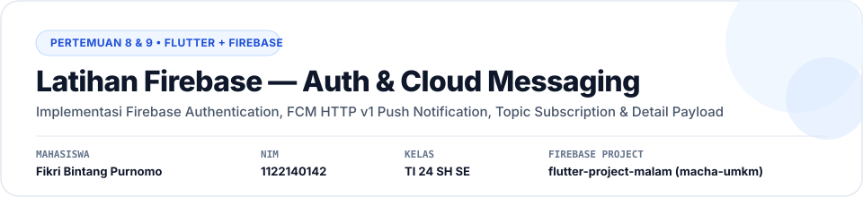
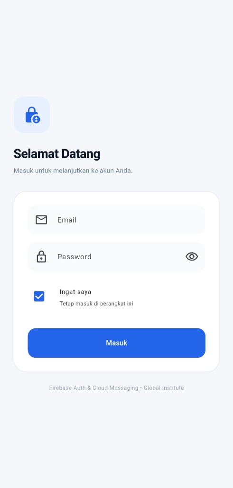
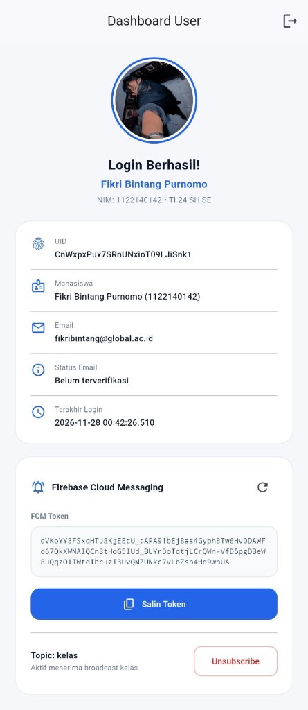
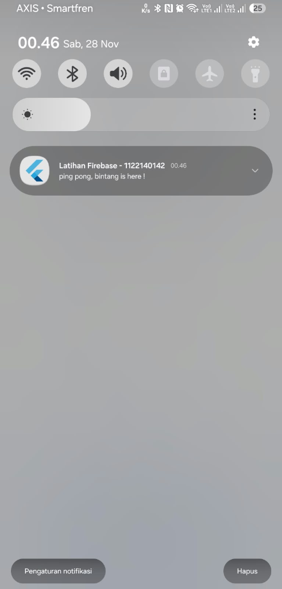
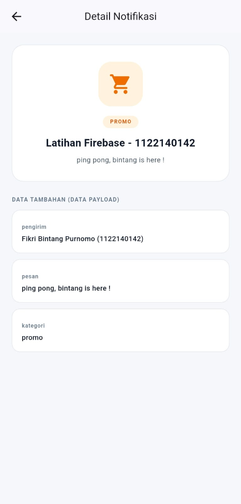

<p align="center">
  
</p>

## Identitas Mahasiswa

| Field | Detail |
|---|---|
| **Nama** | Fikri Bintang Purnomo |
| **NIM** | `1122140142` |
| **Kelas** | `TI 24 SH SE` |
| **Firebase Project** | `flutter-project-malam` (`macha-umkm` · Sender ID `194613325888`) |

---

## Hasil Pengujian Aplikasi

<table>
  <tr>
    <td align="center" width="25%">
      <br />
      <b>1. Halaman Login</b><br />
      <sub>Firebase Authentication + Ingat Saya</sub>
    </td>
    <td align="center" width="25%">
      <br />
      <b>2. Dashboard &amp; FCM Token</b><br />
      <sub>Profil User, Salin Token &amp; Topic <code>kelas</code></sub>
    </td>
    <td align="center" width="25%">
      <br />
      <b>3. Push Notification Masuk</b><br />
      <sub>Channel <code>high_importance_channel</code></sub>
    </td>
    <td align="center" width="25%">
      <br />
      <b>4. Detail Notifikasi</b><br />
      <sub>Ikon <code>promo</code> &amp; Data Payload</sub>
    </td>
  </tr>
</table>

---

## Fitur yang Diimplementasikan

- **SplashScreen** — Layar pembuka dengan animasi transisi menuju `AuthWrapper`.
- **Firebase Authentication** — Login & Logout real-time (`authStateChanges`), opsi *Ingat saya*, toggle show/hide password, serta profil user (`displayName`, `photoURL`, `UID`, `email`, status verifikasi, dan waktu login terakhir).
- **Firebase Cloud Messaging (FCM HTTP v1)** — Penanganan notifikasi pada 3 skenario:
  - **Foreground**: ditampilkan lewat `flutter_local_notifications` pada channel `high_importance_channel`.
  - **Background**: ditangani oleh `FirebaseMessaging.onMessageOpenedApp`.
  - **Terminated**: ditangani oleh `FirebaseMessaging.instance.getInitialMessage()` dan launch details.
- **Detail Notifikasi (`NotificationDetailScreen`)** — Menampilkan judul, isi, seluruh data payload, serta ikon khusus keranjang belanja (`Icons.shopping_cart_rounded`) jika `kategori == "promo"`.
- **FCM Token Card (`FcmTokenCard`)** — Menampilkan FCM Token, tombol **Salin Token**, refresh token, serta tombol **Subscribe / Unsubscribe** untuk topic `kelas`.
- **Postman & Backend Sender** — Tersedia koleksi Postman di [`postman/FCM_Postman_Collection.json`](postman/FCM_Postman_Collection.json) dan backend pengirim notifikasi (PHP / Python / Golang) di [`notification_sender/`](notification_sender/).

---

## Struktur Proyek

```text
lib/
├── main.dart                       # Entry point, AuthWrapper, LoginScreen, UserInfoScreen
├── splash_screen.dart              # SplashScreen animasi
├── firebase_options.dart           # Konfigurasi Firebase (Android, iOS, Web)
├── notification_service.dart       # Izin, channel Android, token, topic, & listener FCM
├── notification_detail_screen.dart # Halaman detail saat notifikasi diklik
└── fcm_token_card.dart             # Kartu FCM token, salin token, & toggle topic kelas
```

## Cara Menjalankan

```bash
flutter pub get
flutter run
```
